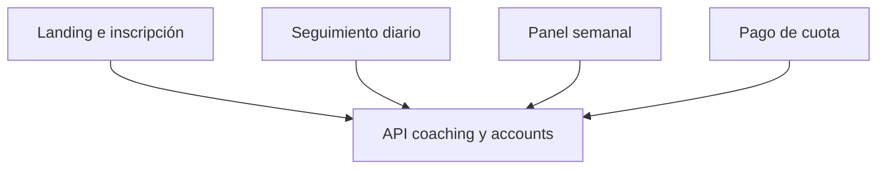

# Arquitectura — Proyecto 90

SPA Vite. La UI grande vive en `app/` (paneles, nutrición, rutinas, mensajes, pago de cuota). `src/` tiene el bootstrap, el cliente `api.ts` y las pantallas de login y reset.

## Estructura

```
src/            App, api.ts, Login, ResetPassword
app/            paneles del participante y del staff
tests/          pruebas de nodos sobre reglas de negocio del cliente
docs/           auditorías y QA del panel
```

## Flujo



El proxy de desarrollo evita CORS contra `localhost:8000`. El build de producción deja la base de la API en el bundle vía `VITE_API_BASE` y se publica por FTPS. El contenedor nginx del `Dockerfile` es un camino alternativo de laboratorio: el workflow del sitio no lo usa.

## Panel

`npm run check:panel` falla el build si el panel de staff desaparece del árbol. Esa compuerta corre dentro de `npm run build` y en el job de verificación del PR.
